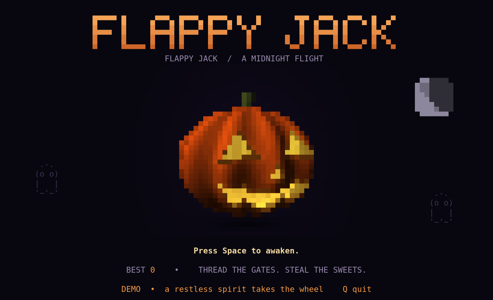
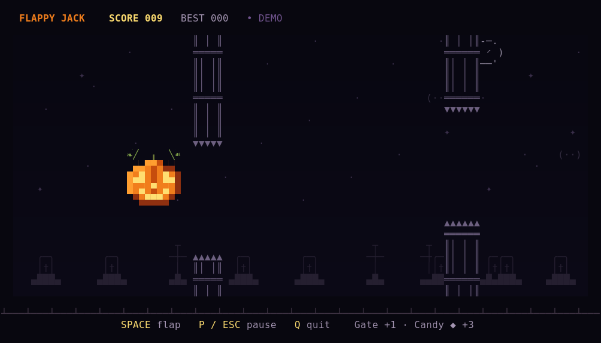

# Flappy Jack

A midnight flight through a haunted terminal. The opening jack-o’-lantern is a **live 3D hollow, ribbed surface**, not an image or a prerecorded animation: it turns, its carved face disappears around the side, and a candle flickers inside.

```sh
cargo run --release
# Deterministic attract mode: five seconds of title, then an autopilot flight.
cargo run --release -- --demo
```

Rust **1.88+**. Use a Unicode/truecolor terminal with a monospace font, **80 × 28 minimum**, ideally **100 × 30** or larger. No assets, services, accounts, or network access are needed to play after building. Ratatui 0.30.2 is the only direct dependency; its matching Crossterm backend supplies input and terminal control.

## Screenshots

Captured from a live **100 × 30** truecolor terminal running `--demo`.





## Controls

| Key | Action |
| --- | --- |
| Space | Awaken / flap / retry |
| R | Retry after dying |
| P or Escape | Pause / resume |
| Q or Ctrl-C | Quit |

Thread the gaps in the crooked cemetery gates. **Each gate is +1; candy ◆ is +3.** Candy does not increase difficulty. Gate openings shrink from 11 to 9 world units, with 39 units of clear space between columns. Gate speed and gap size gradually become harder, then stop increasing. Your collision box is deliberately smaller than Jack’s visible body and decorative leaves. Watch his eyes when danger approaches.

Starting and restarting **do not flap**. Supported terminals are asked to report repeat/release events: repeats are ignored and release permits an immediate fresh tap. Legacy terminals get a 350 ms quiet-key guard; they cannot distinguish a new press from a held key whose first repeat arrives later than that. Release Space after awakening, then tap to fly. Death has a short seed burst; **R retries immediately**, with Space available after the guard. Shrinking the terminal freezes physics and shows “Resize to continue”; restoring its size resumes without catching up the missed time. Manual pause remains paused through a resize.

Best scores are saved atomically to `$XDG_DATA_HOME/flappy-jack/best-score`, or `$HOME/.local/share/flappy-jack/best-score`. Missing, malformed, or unwritable storage never prevents play. Run one instance per score directory: concurrent writes are atomic but not locked against a lower record replacing a higher one. Demo mode is seeded and never reads or writes your personal record. Its autopilot uses the same flap action, gravity, collision checks, gates, and scoring as a human player.

## Architecture

- `src/pumpkin.rs`: implicit ribbed shell, carved openings, inner wall and stem; ray/surface intersection depth, finite-difference normals, diffuse/specular shading and warm interior emission. Two square samples per terminal cell are packed into `▀` for character-aspect correction.
- `src/title.rs`: shared title/game-over composition, procedural wordmark, moon and subtle ghosts.
- `src/game.rs`: pure seeded 100 × 24 world; 120 Hz fixed-step physics, conservative hitboxes, bounded/passable gaps, candy and score-once gates. No rendering or terminal I/O.
- `src/app.rs`: title/playing/paused/game-over states, integer fractional-tick accumulator, input policy and persistence integration.
- `src/ui.rs`: centered cemetery, gates, shaded half-cell pumpkin sprite with carved expressions, leaves, seed burst, HUD and overlays. The playfield grows to at most 100 × 24 cells so the visible core always covers its inner hitbox; partially solid gate-boundary rows retain their visible spikes.
- `src/terminal.rs`: deadline-driven 30 FPS rendering, resize handling, raw/alternate-screen guard, error and panic cleanup. Animation and physics do not depend on rendering cadence.
- `src/storage.rs`: small validated best-score file and atomic replacement.

`CONTRACT.md` records the interfaces and ownership agreed before parallel work. Three Orca dispatches used separate Git worktrees/branches for renderer/title, gameplay, and app/terminal/storage. The coordinator reviewed and cherry-picked contributions incrementally, retained ownership of final composition, and inspected the real PTY pumpkin before integrating gameplay.

## Checks

```sh
cargo fmt --check
cargo clippy --all-targets -- -D warnings
cargo test
```

The 40 tests cover geometry/depth/rotation and carved illumination, sprite shape/shading/expressions, screen sizes/states, visible collision fairness, exact collision contacts, scoring once, candy bonuses, capped/passable difficulty, render-rate independence, three-minute autopilot survival across seeds, pause/resize, delayed repeat/release handling, CLI validation and isolated storage failures.

Also verified on Linux in real PTYs: title/gameplay output at 80 × 28, 100 × 30 and 160 × 50; start/flap/death/retry/pause/resize/quit; score 9 saved and loaded by a fresh process; enhanced keyboard events; and terminal restoration after injected panic, initialization and drawing failures. Title rendering used about 5% of one CPU core at 100 × 30 in the local release build (hardware-dependent).

API references: [official installation](https://ratatui.rs/installation/), [release-matched examples](https://ratatui.rs/examples/), [Canvas demo](https://ratatui.rs/examples/apps/canvas/), and [Ratatui API](https://docs.rs/ratatui/0.30.2/ratatui/).
